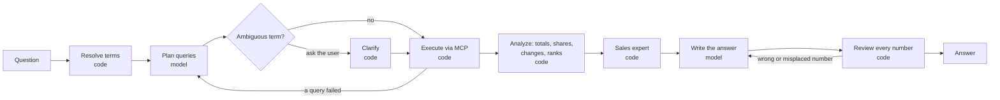

# Analyst Console

Ask questions about your business data in plain words and get answers you can trust: every number is
computed by code from governed metric definitions and checked before you see it.

**Live:** [analyst.medamine.work](https://analyst.medamine.work) (invite-only; sign-in required)

## Why it exists

A chatbot connected to a database can produce a confident answer with a wrong number in it. Analyst
Console splits the work so that cannot happen silently:

- **The model plans and writes.** It decides which metrics and breakdowns answer the question, and it
  writes the sentences.
- **Code does everything else.** It runs the queries through a governed semantic layer (dbt +
  MetricFlow), does all the arithmetic (totals, shares, changes, ranks), and reviews the answer: every
  number must exist in the computed results *and* sit next to the group and period it belongs to.

The result is measured, not assumed. On questions held back until the system was frozen:

| Agent | Right on a single run | Right on every one of 3 runs | Tokens per question | Time |
|---|---|---|---|---|
| A standard tool-calling agent (baseline) | 83% | 50% | 7,893 | 37.4 s |
| **This agent** | **88%** | **88%** | **3,400** | **18.8 s** |

Reliability went from 50% to 88% with 57% fewer tokens. The baseline's misses were random; this
agent's were systematic, so each one became a fix with a test.

## What it does

- **Ask** in plain words; see the answer, the data tables, a chart chosen for the question (bars,
  lines, areas, heatmaps, treemaps, waterfalls), and every step the agent took.
- **Your own data:** upload CSV files or a database file, or connect a live PostgreSQL or MySQL
  database (read-only). Each source gets generated, sales-aware metrics (revenue, orders, average order
  value, gross margin, discount rate and more), each with a definition that says how it is computed.
- **A dashboard per source,** computed without the model: headline numbers against the previous 30 days,
  trends and breakdowns. Live databases refresh themselves.
- **A sales-expert agent** that knows what sales words mean ("basket size", "panier moyen"), which way
  is good for each measure, and which chart answers which question. It is code over a reviewed knowledge
  file, so it costs no tokens.
- **The query in your language:** each answer's queries translated to PostgreSQL, MySQL, SQL Server,
  Oracle (SQL and PL/SQL), Snowflake, BigQuery, SQLite or a MongoDB pipeline, with each engine's exact
  date handling; translations are verified by running them.
- **Connections:** import from a link, Google Sheets and Drive, Airtable, Notion, HubSpot or any MCP
  server; send answers to Slack, Teams or Excel. Other apps can ask through a JSON API or an MCP endpoint.
- **Accounts and security:** invite-only accounts, two-step sign-in, session management, encrypted
  credentials, per-user limits and a shared daily token budget; users can bring their own Claude, GPT,
  Gemini or Groq key.

## How an answer is built



The model is called twice per question (plan and write). Everything that touches a number is code.

## Stack

Python 3.12, LangGraph, the MCP Python SDK (v2), dbt + MetricFlow on DuckDB, FastAPI; React 19, Vite,
Tailwind 4, Apache ECharts; Groq (`openai/gpt-oss-120b`) by default. Deployed with Docker Compose behind
Caddy, by CI.

## Run it locally

Requires Python 3.12 and Node 20.19+. In PowerShell:

```powershell
python -m venv .agent; .agent\Scripts\Activate.ps1
pip install -r requirements.txt -r requirements-dev.txt
cd warehouse; dbt build; cd ..                     # build the sample warehouse
$env:CONSOLE_AUTH = "off"                          # or create an account: python -m app.api.users add <name>
uvicorn app.api.main:app --port 8001               # needs GROQ_API_KEY in .env
cd web; npm install; npm run dev                   # http://localhost:5173
```

No key? `uvicorn scripts.demo_console:app --port 8001` runs the console with a scripted model on its
example questions.

Tests: `ruff check .` and `pytest -q` (no test calls a model). Evaluation:
`python -m evals.run_eval --agent orchestrated --set v2 --repeats 3`, summarized with
`python -m evals.report evals\results\<file>.jsonl`.

## Repository map

| Folder | What is in it |
|---|---|
| `warehouse/` | dbt project: seeds, staging, marts, data tests, the semantic layer (metrics) |
| `app/semantic/` | the only code that touches MetricFlow; query translation to other languages |
| `app/mcp_server/` | the metrics as MCP tools |
| `app/agents/` | the orchestrated agent, the baseline agent, the sales expert, model providers |
| `app/sources/` | users' own data: profiling, generated metrics, builds |
| `app/connectors/` | imports and exports, through one safe HTTP layer |
| `app/api/` | the console's API: accounts, security, answers, dashboards, translation |
| `web/` | the console (React) |
| `evals/` | question sets, scoring, runs and reports |
| `docs/` | the development log and connector setup |

The development log (`docs/DEV_LOG.md`) records each phase, every fix and the interview stories behind
the design choices.
